# Telegram-бот-квиз для сбора брифа на сайт

Демонстрационный проект: Telegram-бот, который проводит клиента по многошаговому квизу и собирает бриф на разработку сайта. Логика и контент вынесены в Google Таблицу, поэтому тексты, кнопки, порядок экранов и условия меняются без правок кода и без перезапуска бота.

> Все данные на скриншотах — демонстрационные.

## Что умеет

- Многошаговый сценарий с четырьмя ветками: 103 экрана, 307 кнопок.
- Одиночный и множественный выбор, отметки-галочки, ограничения «минимум/максимум», взаимоисключающие варианты.
- Кнопка «Назад» через стек истории: сообщение редактируется на месте, дублей нет.
- Текстовые ответы, ввод телефона с проверкой, обязательные поля.
- Условные экраны (`condition` / `skip_to`), временное отключение экранов.
- Заявка сохраняется в таблицу, клиенту и менеджеру уходит готовый HTML-бриф файлом.
- Всё содержимое — в Google Sheets: экраны, кнопки, настройки. Правка применяется со следующего сообщения.

## Стек

- **n8n** — исполнение логики (Cloud или self-hosted Community).
- **Google Sheets** — контент, состояние сессий, заявки.
- **Telegram Bot API** — приём апдейтов и отправка сообщений.

## Архитектура

```text
Telegram Trigger (message / callback_query)
  -> Normalize                 приведение апдейта к единому виду
  -> Get Settings / State / Screens / Options   чтение из Google Sheets
  -> Engine                    навигация, ответы, рендер клавиатуры
  -> Is Callback -> Answer Callback
  -> Edit? -> Edit Message / Send Message       HTTP Request к Bot API
  -> Need Brief? -> Build Brief -> Send Brief -> Save Lead -> Save State
```

Ключевые решения:

- Один апдейт = один короткий execution, без `Wait` и долгих циклов.
- Состояние пользователя (текущий экран, ответы, история «Назад») хранится в листе `Users_Current_State`.
- Штатный узел Telegram не умеет динамический `reply_markup`, поэтому `sendMessage`/`editMessageText` вызываются через **HTTP Request**, а `reply_markup` передаётся JSON-строкой. `Answer Callback Query` и `Send Document` — штатными узлами.
- Контент не дублируется в коде: движок интерпретирует строки таблицы.
- Флаг «заявка сохранена» хранится отдельной колонкой `lead_saved`, поэтому повторный вход на финальный экран не создаёт дубль.

## Логика движка

Данные кнопок передаются через `callback_data`:

| Значение | Действие |
|---|---|
| `o:<screen_id>:<option_id>` | выбор варианта / переключение | 
| `d:<screen_id>` | подтверждение мультивыбора («Готово») | 
| `b` | назад по истории |

Переходы:

- `next_screen_id` — прямой переход или `{back}` (вернуться на предыдущий экран из стека).
- `condition` — условие показа, например `promo_current in [paid, seo]`; если условие ложно, экран пропускается по `skip_to`.
- `exclusive` — вариант снимает остальные выбранные (например, «Нет»).
- `validation` — `phone`, `email`, `number` или `none`.

## Структура репозитория

```text
n8n/
  normalize.js   Code-узел: нормализация апдейта Telegram
  engine.js      Code-узел: навигация, ответы, рендер клавиатуры, заявка
  brief.js       Code-узел: HTML-бриф и данные заявки
images/          скриншоты интерфейса и админки
```

## Схема Google Таблицы

| Лист | Колонки |
|---|---|
| `Screens` | `screen_id, type, text, parse_mode, next_screen_id, min_select, max_select, confirm_label, required, validation, is_active, sort_order, back_screen_id, status, condition, skip_to, notes` |
| `Options` | `screen_id, option_id, label, action, value, exclusive, next_screen_id, sort_order, is_active` |
| `Settings` | `key, value, notes` |
| `Users_Current_State` | `telegram_id, screen_id, answers_json, back_stack_json, lead_saved, updated_at` |
| `Leads` | `lead_id, created_at, telegram_id, name, phone, messenger, contact_time, answers_json, brief_file` |

Типы экранов: `message`, `single`, `multi`, `text`, `phone`, `document`.
Действия кнопок: `goto`, `toggle`, `input`, `url`.

## Администрирование без кода

1. Открыть `Screens` и изменить текст, порядок или переходы.
2. В `Options` поправить подписи, добавить новую кнопку.
3. В `Settings` задать ссылки, подпись «Назад», заголовок брифа, чат менеджера.
4. Изменения вступают в силу со следующего сообщения — публикация не нужна.

Важно: связи задаются по идентификаторам (`screen_id`, `option_id`), а не по тексту кнопки.

## Развёртывание

1. Создать Telegram-бота и получить токен.
2. Создать Google Таблицу с листами из схемы выше и импортировать контент.
3. Подключить в n8n credentials Telegram и Google Sheets.
4. Собрать workflow по схеме из раздела «Архитектура», вставить код из `n8n/`.
5. Включить `Execute Once` на узлах чтения (`Get Settings`, `Get State`, `Get Screens`, `Get Options`).
6. Заполнить `Settings` и опубликовать workflow.

Секреты (токен бота, ID чатов, доступы) в репозитории не хранятся.

## Скриншоты

<table>
<tr>
<td align="center">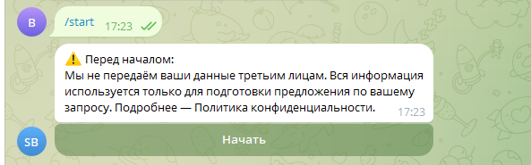<br><sub>Старт</sub></td>
<td align="center">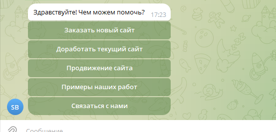<br><sub>Главное меню</sub></td>
<td align="center">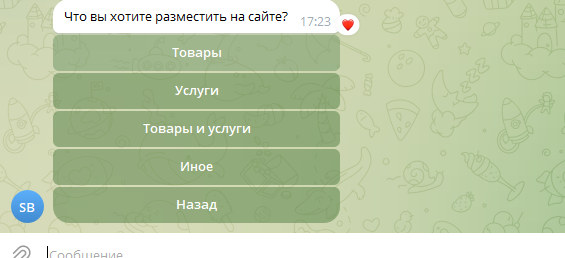<br><sub>Одиночный выбор</sub></td>
</tr>
<tr>
<td align="center">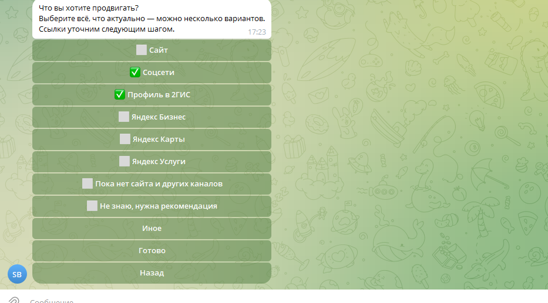<br><sub>Мультивыбор</sub></td>
<td align="center">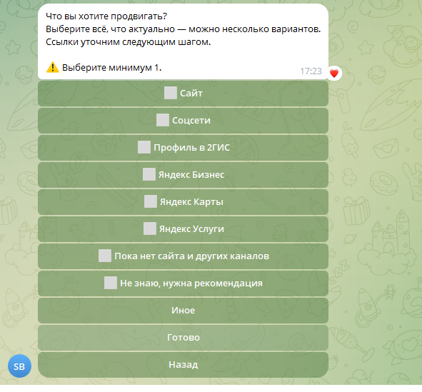<br><sub>Валидация</sub></td>
<td align="center">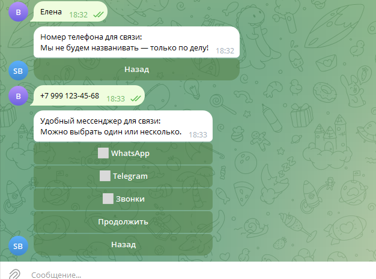<br><sub>Контакты</sub></td>
</tr>
<tr>
<td align="center">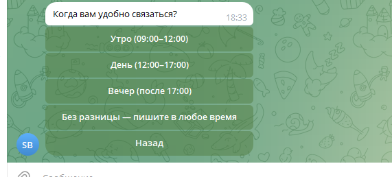<br><sub>Удобное время</sub></td>
<td align="center">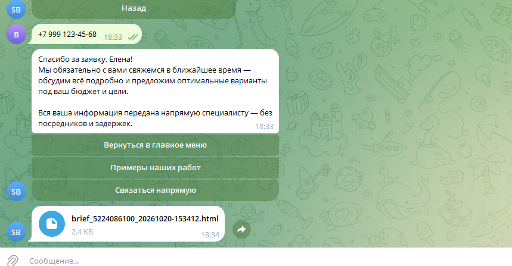<br><sub>Финал и файл брифа</sub></td>
<td align="center">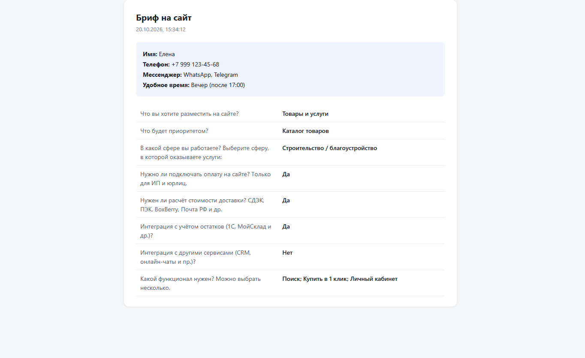<br><sub>HTML-бриф</sub></td>
</tr>
</table>

Админка — всё содержимое и заявки в Google Таблице:

<table>
<tr>
<td align="center">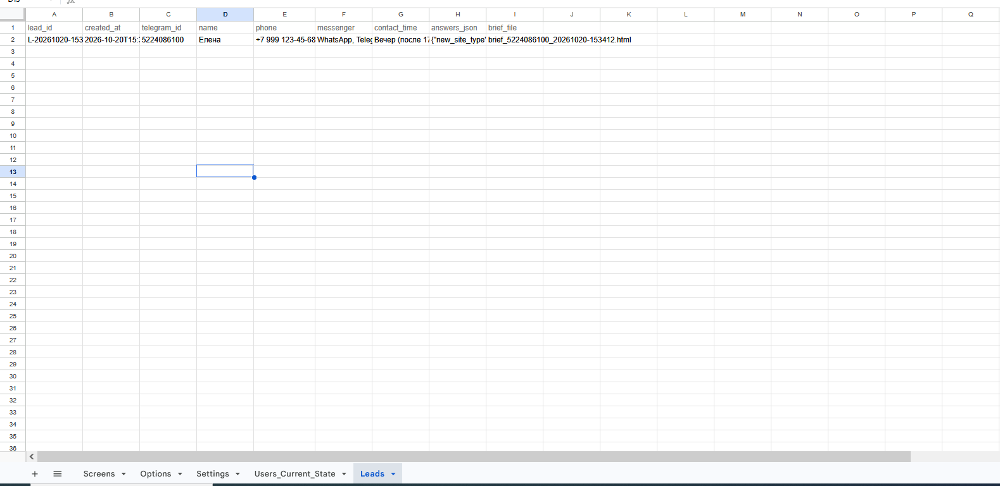<br><sub>Заявки</sub></td>
<td align="center">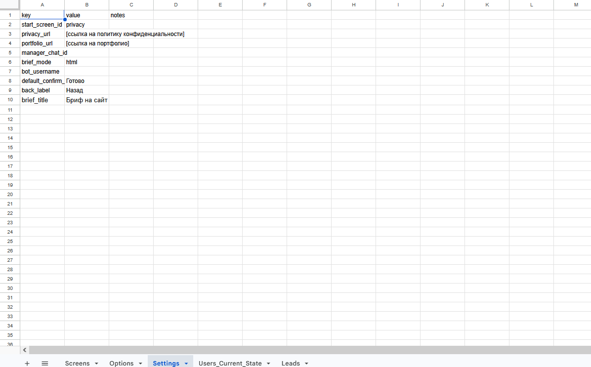<br><sub>Настройки</sub></td>
<td align="center">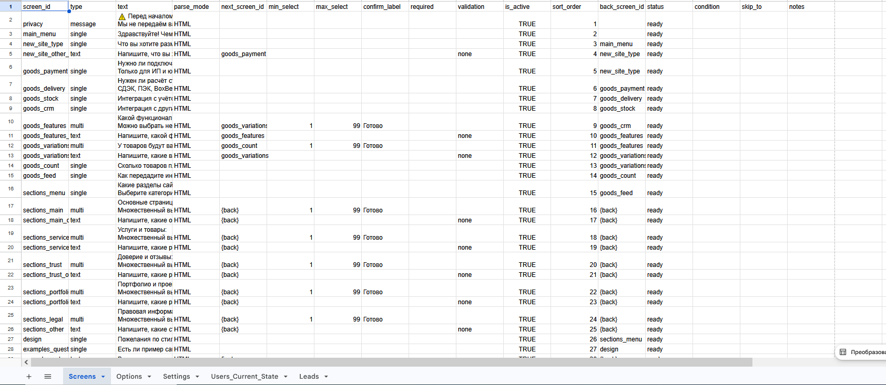<br><sub>Сценарий</sub></td>
</tr>
</table>

Workflow в n8n:

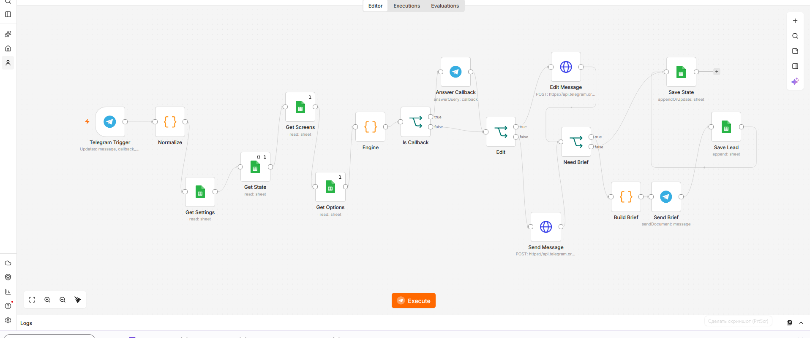


## Ограничения

- Отклик на нажатие — около 2–3 секунд: каждый шаг это отдельный запуск сценария и чтение таблицы.
- При очень быстрых повторных нажатиях в мультивыборе возможна гонка состояний; лечится ранним `answerCallbackQuery` и кэшированием контента.
- Загруженный пользователем файл сохраняется как `file_id` и не пересылается менеджеру автоматически.
- Лимиты зависят от выбранного тарифа n8n: на бесплатном тестовом доступе ограничены число запусков и одновременно выполняемых сценариев.
